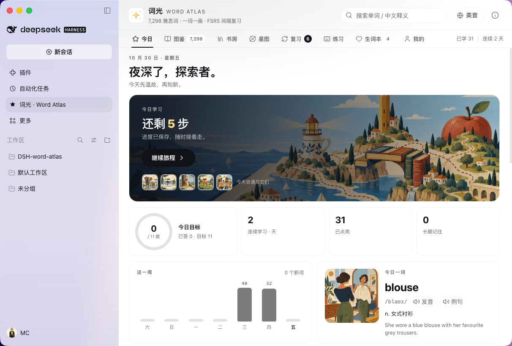
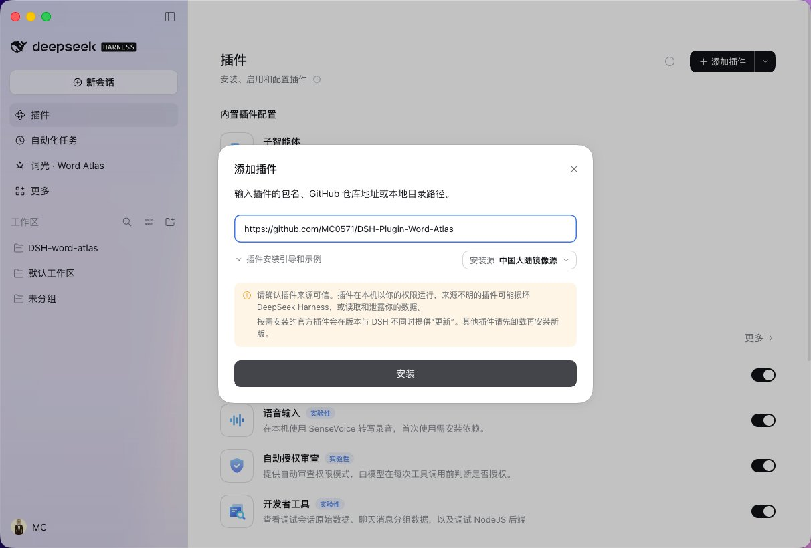

# 词光 for DeepSeek Harness

7,298 个雅思词 · 一词一画 · 英美发音 · FSRS 间隔复习 · 进度只留本机

社区维护的第三方 DSH 插件 · 非词光官方仓库

[**安装插件**](#安装)　·　[功能一览](#功能一览)　·　[常见问题](#常见问题)　·　[开发文档](docs/DEVELOPMENT.md)

[](https://github.com/MC0571/DSH-Plugin-Word-Atlas/tags)
[](https://github.com/MC0571/DSH-Plugin-Word-Atlas/actions/workflows/ci.yml)
[](LICENSE)
[](THIRD_PARTY_NOTICES.md)



<sub>词光 for DeepSeek Harness 运行在 DSH 桌面端：左侧是 DSH 侧边栏，右侧是今日页——学习计划、连续天数、本周统计与今日一词。</sub>

---

**词光 for DeepSeek Harness** 是一套插画雅思词汇插件。点开侧边栏的「词光」，每个词都是一张插画词卡：
先看画面理解词义，再听英音美音，然后做主动回忆练习，最后交给 FSRS 在快忘的时候提醒你复习。

**免费开源、无需账号，学习进度只保存在你的电脑上。**

> 本仓库是社区维护的第三方插件，不是词光官方仓库，与词光原作者无隶属关系。词库、插画与发音来自上游开源项目[词光 · Word Atlas](https://github.com/designfuchen/word-atlas)（CC BY 4.0），插件代码以 MIT 授权。

## 安装

**推荐：在 DSH 界面里手动添加。**

1. 侧边栏打开「插件」，点右上角「**添加插件**」；
2. 在输入框粘贴仓库地址：

   ```text
   https://github.com/MC0571/DSH-Plugin-Word-Atlas
   ```

3. 点「安装」，等进度完成。侧边栏出现「词光」图标后点开即可。



<sub>「插件 → 添加插件」，粘贴仓库地址后点「安装」；网络慢时可切换安装源。截图保留 DSH 侧边栏，用来说明安装环境。</sub>

安装会请求 `danger-full-access` 或审批：插件需要写入自己的目录、进度文件和素材缓存（`$DSH_HOME/word-atlas-dsh/`）。装完后不再额外授权，也不会把学习数据上传到任何服务器。

**装完自检（约 30 秒）：**

| 检查 | 应该看到 |
| :--- | :--- |
| 侧边栏 | 出现「词光」图标 |
| 今日页 | 今日计划、连续天数，以及一张可以点的词卡 |
| 词卡 | 插画、英美音标、中文释义，点播放能听到发音 |
| 素材 | 联网时插画和发音按需加载，无需先下载 |

<details>
<summary><b>用 plugin_manager 安装（脚本 / 自动化）</b></summary>

```text
action: install_bundle
target: https://github.com/MC0571/DSH-Plugin-Word-Atlas.git
```

本地开发安装把 `target` 指向本仓库目录即可，见[开发文档](docs/DEVELOPMENT.md)。
</details>

## 这是什么，适合谁

- **给谁**：备考雅思的中文母语学习者，每天能拿出 10–20 分钟，想先把「认词」这一步练扎实。
- **解决什么**：背了就忘；词义和画面脱节；学英语时还要在 App、网页和笔记之间来回切换。
- **怎么做到**：一词一画建立画面锚点 → 四种题型逼你主动回忆 → FSRS 只在快忘的时候安排复习。
- **不适合谁**：需要真人批改作文、口语陪练，或者期待「一键提分」的人——这是词汇工具，不承诺分数。

做成插件的好处也很直接：不用离开 Harness 去开另一个 App；Agent 也能直接查同一份词库；学习记录留在本机，不注册、不同步。

## 学习闭环

| 环节 | 你会做什么 |
| :--- | :--- |
| **看见** | 每个词一幅原创插画，配中英释义、两条例句，以及搭配、词族和用法提示。 |
| **听见** | 英音、美音随时切换；例句有朗读，1,011 个重点词的第二条例句也配了录音。 |
| **想起** | 看义选词、看图补句、听音辨词、拼写，四种题型交替出现；答错会重新排进本轮。 |
| **复习** | FSRS 按答题记录排期，只有首次作答计入正确率；没有到期词时也能自由复习已学词。 |
| **积累** | 星图按话题点亮学习状态，打字练习统计 WPM 与准确率，进度可导出备份。 |

## 功能一览

| 入口 | 能做什么 |
| :--- | :--- |
| **今日** | 每日计划、目标圆环、连续天数、本周统计、今日一词、A1–C2 学习路线、19 个话题入口。 |
| **图鉴** | 7,298 个词，按 CEFR、话题和中文释义筛选搜索，每个词都能打开插画词卡。 |
| **书房** | 732 篇分级短文（双语对照、点词查义、T/F/NG 理解题）和《小王子》沉浸式阅读（三种阅读方式、字号行距、逐句朗读、聆听模式、章节进度）。 |
| **星图** | WebGL2 渲染的词汇星系，19 个话题成簇，按学习状态明暗；拖动旋转、滚轮缩放，点星开词卡。 |
| **复习** | 到期词优先出题；重来 / 困难 / 良好 / 简单四档评分；也可以自由复习已学词。 |
| **练习** | 单词、例句、听写三种打字模式，实时 WPM 与准确率，可从最近学过、错词、收藏或学习路线取词。 |
| **生词本** | 收藏与错词集中管理，随时回看、集中攻破。 |
| **我的** | 统计条、20 周热力图、7 天复习预测、目标记忆率、备份导入导出、离线素材下载。 |

> 两个顺手的小功能：例句里点任意英文词就能查义并播放发音；⌘K（Windows 为 Ctrl+K）打开命令面板，搜索词条或跳转页面。

## 内容与数据

| 资源 | 数量 |
| :--- | :--- |
| 词条 | **7,298** 条，CEFR A1–C2，19 个话题 |
| 例句 | **14,596** 条，日常与雅思语境，附中文翻译 |
| 插画 | **7,298** 幅，512 px WebP，另有网格用缩略图 |
| 录音 | **22,905** 段：英音、美音、例句朗读（1,011 个重点词还有第二条例句录音） |
| 书房 | **732** 篇分级短文 + 1 本《小王子》（章节 + 朗读音频） |

**词库从哪里来。** 词库文字来自上游开源项目[词光 · Word Atlas](https://github.com/designfuchen/word-atlas)（CC BY 4.0）。插件内置词库索引与分块（`data/`，约 7 MB），所以没有本机素材也能浏览全部词条；插画与发音优先从本机词光仓库读取，找不到时按需从上游词光站点（`0xlei.tech`）加载。

**需要知道的局限。** 释义、例句、插画与录音由生成式 AI 制作，并经过自动的结构与一致性校验，但**尚未逐条人工审校**，可能有个别释义、例句或发音错误；它不是官方雅思词表，也不承诺提分。发现错误欢迎[提交词条纠错](https://github.com/MC0571/DSH-Plugin-Word-Atlas/issues/new/choose)，附上词条 ID 即可。

## 离线使用

默认联网按需加载：打开一个词，才下载它的插画和发音。想在通勤、飞机上也能用，可以在「我的 → 离线素材」里按需下载：

| 档位 | 大小 | 适合 |
| :--- | ---: | :--- |
| 缩略图 | 84 MB | 网格浏览、查词浮窗；只背单词的话够用 |
| 完整插画 | 199 MB | 想离线看词卡大图 |
| 发音 | 418 MB | 想离线听英音、美音和例句朗读 |

三档全部下载约 701 MB（37,501 个文件），支持暂停、续传和删除，下载过程中已完成的素材立即可用。如果本机已经克隆了[词光仓库](https://github.com/designfuchen/word-atlas)，也可以直接从本地导入，完全离线。

## 给 Agent 用

装好插件后，Harness 里的模型也能查这份词库：

| 工具 | 用途 |
| :--- | :--- |
| `word_atlas_lookup` | 按单词或词条 ID 返回完整词条：英美音标、CEFR、话题、中英释义、例句、搭配、词族、提示与插画链接 |
| `word_atlas_search` | 按英文、中文释义或音标搜索，可按 CEFR 与 19 个话题过滤 |

比如让 Agent「用 word_atlas_lookup 查一下 principle，顺便给两个雅思例句」，它会直接返回结构化词条，不需要另开词典。不想让模型看到词库时，在配置里设 `tools: false` 即可（配置项见[开发文档](docs/DEVELOPMENT.md)）。

## 隐私与数据

- 无需注册、无需账号，没有云端同步。
- 学习进度保存在本机：`$DSH_HOME/word-atlas-dsh/progress.json`（浏览器里另有一份镜像）。
- 只有播放发音、浏览插画时才请求素材，来源是本机词光仓库或上游词光站点。
- 换设备或重装前，在「我的 → 数据与备份」导出备份，新设备导入即可；备份格式与上游词光兼容。
- 卸载插件不会自动删除进度文件；确认不再需要后，可手动删除上述目录。

## 常见问题

<details>
<summary><b>这个插件和词光原项目是什么关系？</b></summary>

本仓库是社区维护的第三方 DSH 插件，不是词光官方仓库，与词光原作者无隶属关系。插件复用上游 [designfuchen/word-atlas](https://github.com/designfuchen/word-atlas) 的 CC BY 4.0 词库、插画与录音，以及部分 MIT 代码，并做了 DSH 适配；插件自身的代码以 MIT 授权。
</details>

<details>
<summary><b>装完侧边栏没有「词光」？</b></summary>

先确认 DSH 的「插件」页里安装成功、没有报错。插件页面注册在 `main` 槽，侧边栏入口注册在 `sidebar.panellist`；仍未出现时，重启 Harness 或重新安装一次。
</details>

<details>
<summary><b>插画或发音加载失败？</b></summary>

默认从上游词光站点按需加载，网络受限时会失败。可以下载离线素材包，或把词光仓库克隆到本机后配置 `contentDir`（见[开发文档](docs/DEVELOPMENT.md)）。
</details>

<details>
<summary><b>安装为什么需要 danger-full-access？</b></summary>

这是 Harness 安装插件的方式：插件需要写入自己的目录、进度文件和素材缓存。装完后不再需要额外权限，插件也不会把学习数据上传到任何地方。
</details>

<details>
<summary><b>换电脑或重装会不会丢进度？</b></summary>

进度只在本机，不会自动同步。换设备前在「我的 → 数据与备份」导出，之后导入即可。备份格式与上游词光兼容。
</details>

<details>
<summary><b>离线包要下多久？多大？</b></summary>

三档共约 701 MB，取决于网速和上游站点速度；日常只背单词，下载缩略图（84 MB）就够了。下载支持取消与续传，已完成的文件不会重复下载。
</details>

## 反馈与参与

- **词条纠错、界面问题、使用建议**：直接提 [Issue](https://github.com/MC0571/DSH-Plugin-Word-Atlas/issues/new/choose)，词条类问题请附**词条 ID**。
- **改代码**：见[开发文档](docs/DEVELOPMENT.md)，提交前跑 `npm run check`。
- 如果词光对你有用，欢迎 Star，或者转给正在备考的朋友。

词光原项目：[designfuchen/word-atlas](https://github.com/designfuchen/word-atlas) · 本插件仓库：[MC0571/DSH-Plugin-Word-Atlas](https://github.com/MC0571/DSH-Plugin-Word-Atlas) · 更新记录：[CHANGELOG.md](CHANGELOG.md) · 授权与第三方内容：[THIRD_PARTY_NOTICES.md](THIRD_PARTY_NOTICES.md)

> 本仓库为非官方第三方插件，与词光官方无隶属关系，不代表上游项目立场。

---

本仓库由 [MC](https://x.com/marchen_cc) 维护。
